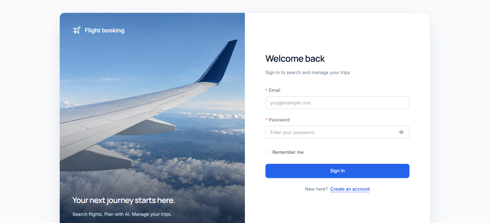
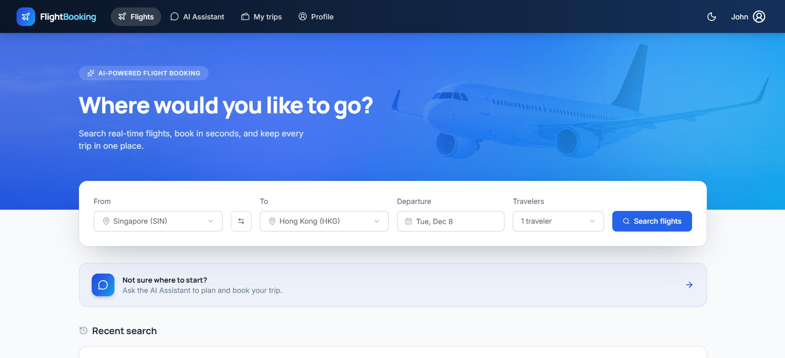
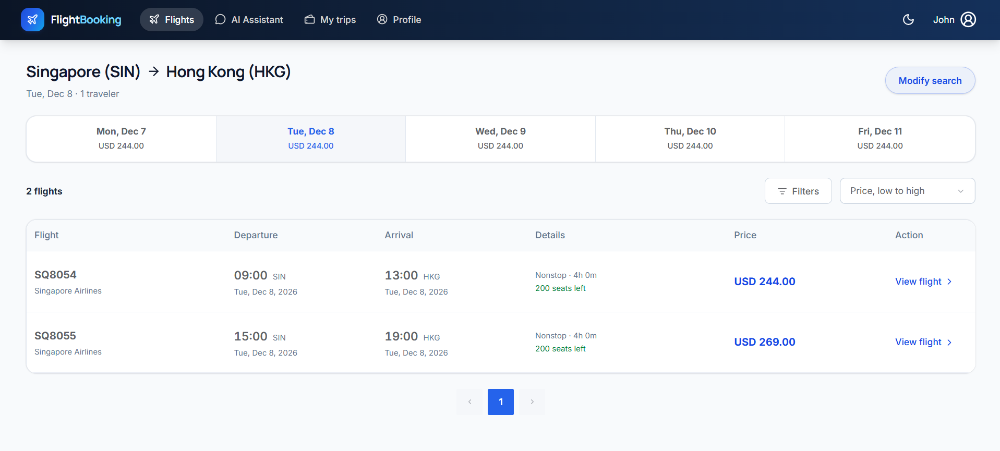
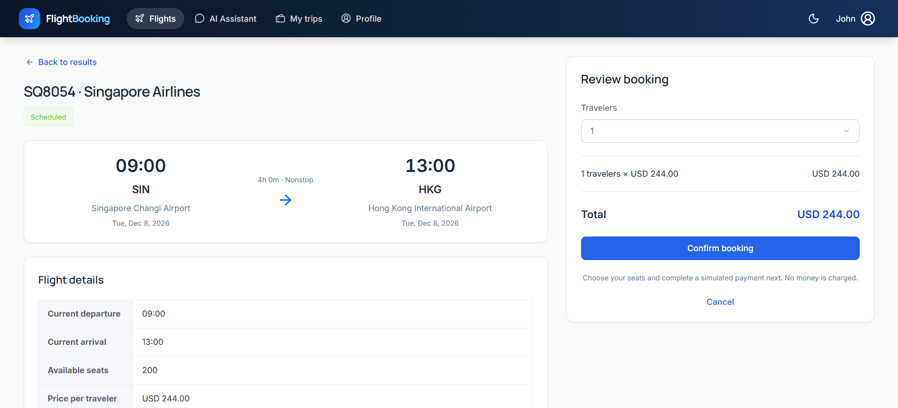
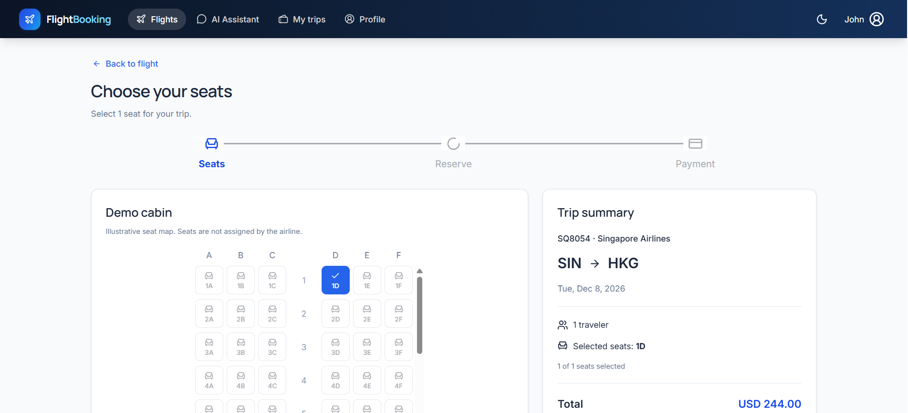
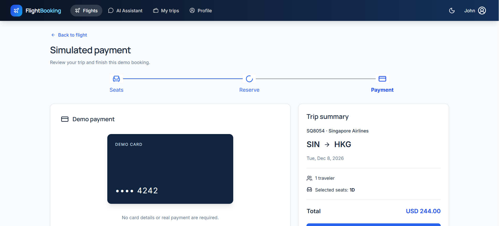
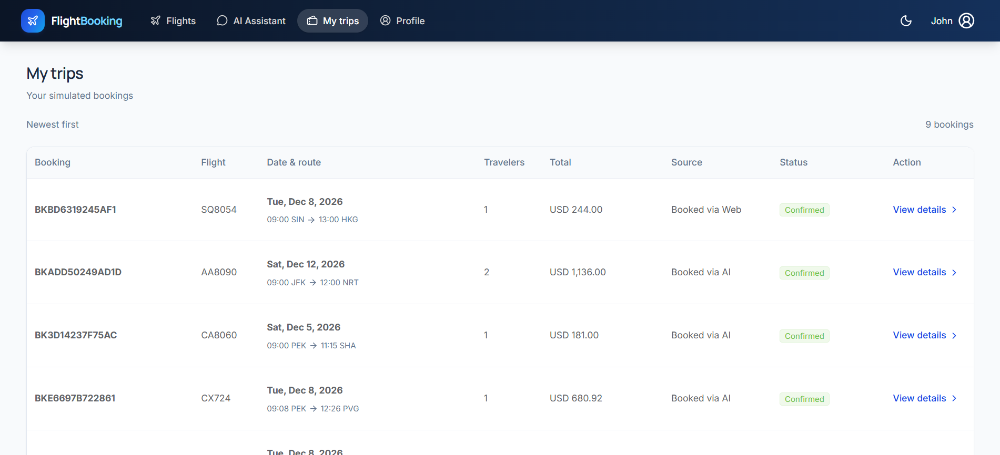
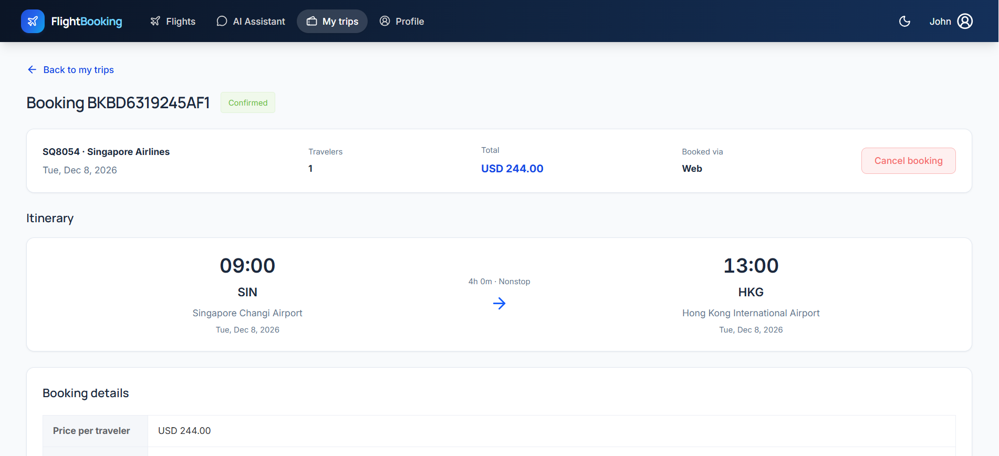
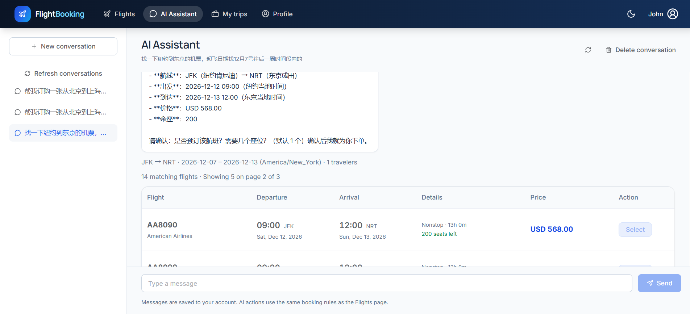
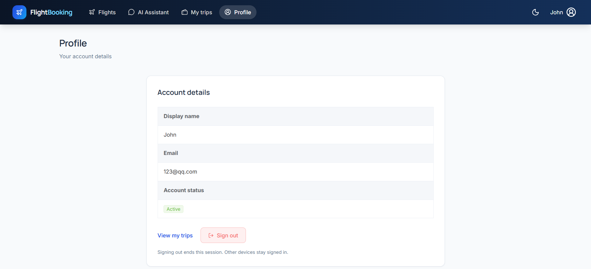

# Flight Booking

A simulated flight-booking application with flight search, reservation management, and an AI assistant. The project has three layers: a Vue frontend, a FastAPI chat service, and a Node.js REST backend backed by MongoDB Atlas.

## Run locally

### 1. Prepare the environment

Requirements:

- **Node.js** `^22.18.0` or `>=24.12.0`, with npm, for the backend and frontend.
- **Python 3.10+** for the AI middle layer.
- **MongoDB Atlas**, or another MongoDB deployment supporting cross-collection transactions, for booking creation and cancellation. The database must be reachable from your machine.
- A **DeepSeek API key** for AI chat. Flight search and the standard booking UI can run with just the backend and frontend.

The commands below use **Windows PowerShell**. Start from the repository root, `FlightBooking/`, when configuring the environment and when opening each service terminal.

Create or update `backend/.env`, preserving any existing configuration and replacing the placeholders:

```dotenv
PORT=3000
NODE_ENV=development
MONGODB_URI=mongodb+srv://<username>:<password>@<cluster>/
MONGODB_DB_NAME=flightBookingDB
JWT_SECRET=<generated-secret>
JWT_EXPIRES_IN=24h
```

Both JWT settings are required: `JWT_SECRET` must contain at least **32 bytes**, and `JWT_EXPIRES_IN` must be a positive integer followed by `s`, `m`, `h`, or `d`, such as `24h`. Generate a random secret and paste its output into `JWT_SECRET`:

```powershell
node -e "console.log(require('node:crypto').randomBytes(32).toString('hex'))"
```

For the middle layer, copy the template only if `middle/.env` does not already exist:

```powershell
if (-not (Test-Path .\middle\.env)) {
    Copy-Item .\middle\.env.example .\middle\.env
}
```

Set `DEEPSEEK_API_KEY` in `middle/.env`. The template supplies the other defaults:

| Setting | Local value / purpose |
| --- | --- |
| `DEEPSEEK_BASE_URL` | `https://api.deepseek.com/beta`, used for strict tool calling. |
| `DEEPSEEK_MODEL` | `deepseek-flash`. |
| `BACKEND_BASE_URL` | `http://localhost:3000`, pointing to the Node.js backend. |
| `CORS_ORIGINS` | `http://localhost:5173`, the frontend origin. |
| `MIDDLE_TIMEZONE` | `Asia/Singapore`, used to interpret relative dates. |

See [middle/.env.example](middle/.env.example) for the complete configuration, including timeouts and tool-round limits.

### 2. Start the backend — terminal 1

Install the locked dependencies and create the database indexes:

```powershell
cd .\backend
npm ci
npm run indexes
```

If the database needs demo airlines, airports, and flights, initialize them before starting the server:

```powershell
npm run seed
```

The seed script updates matching reference data and flight prices/schedules, so use it only when you want the bundled demo data. Its flights are dated **December 8, 10, and 12, 2026**; search those dates when trying the demo.

Start the backend with automatic restart on source changes:

```powershell
npm run dev
```

The backend listens on `http://localhost:3000` after MongoDB connects. Use `npm start` instead when you do not need file watching. Index creation is especially important with `NODE_ENV=production`, where automatic index creation is disabled.

### 3. Start the AI middle layer — terminal 2

Open a new PowerShell terminal at the repository root:

```powershell
cd .\middle
python -m venv .venv
.\.venv\Scripts\python.exe -m pip install -r requirements.txt
.\.venv\Scripts\python.exe -m uvicorn app:app --host 127.0.0.1 --port 8000 --workers 1
```

These commands use the virtual environment's Python directly, so activation is unnecessary. On later runs, reuse `.venv` and run the final command. Keep **one worker and one service instance** because conversation execution locks are process-local; saved conversations are persisted through the backend.

### 4. Start the frontend — terminal 3

Open another PowerShell terminal at the repository root:

```powershell
cd .\frontend
npm ci
npm run dev
```

Open [http://localhost:5173](http://localhost:5173), or the address printed by Vite. The development proxy forwards `/api/*` to the backend on port **3000** and rewrites `/chat-api/*` to the middle layer's `/api/*` routes on port **8000**. No frontend `.env` is needed for this setup. If you change service ports, update [frontend/vite.config.ts](frontend/vite.config.ts) and the relevant middle-layer settings to match.

### 5. Verify the services

| Service | Address | Expected result |
| --- | --- | --- |
| Backend health | [http://localhost:3000/api/health](http://localhost:3000/api/health) | `status: "ok"` and `database.status: "connected"`. |
| Middle-layer health | [http://127.0.0.1:8000/health](http://127.0.0.1:8000/health) | `backend.reachable: true` and `backend.status: 200`. |
| Middle-layer API docs | [http://127.0.0.1:8000/docs](http://127.0.0.1:8000/docs) | Swagger UI; use the login response's `data.accessToken` in **Authorize**, without the `Bearer` prefix. |
| Frontend | [http://localhost:5173](http://localhost:5173) | Register or log in, search flights, manage bookings, and open AI chat. |

The middle-layer health route checks backend connectivity, not the DeepSeek API key. Send a message through AI chat to verify the model connection.

Keep all three terminals running while using the full application; press `Ctrl+C` in each terminal to stop its service. After the initial setup, start each service from its own directory with `npm run dev`, `.\.venv\Scripts\python.exe -m uvicorn app:app --host 127.0.0.1 --port 8000 --workers 1`, and `npm run dev`, respectively. Reinstall dependencies when their lockfiles or requirements change.

## Backend — `backend/`

Built with **Node.js, Express, Mongoose, and MongoDB Atlas**. The backend owns database access, authentication, seat availability, and booking rules for both the standard UI and AI tools.

Booking creation and individual cancellation use **cross-collection transactions** to update bookings and seat inventory together. User-scoped UUID idempotency keys prevent duplicate bookings and repeated seat deductions when requests are retried. Bookings retain the price agreed at creation.

| API area | Responsibility |
| --- | --- |
| Authentication | Registration, login, current-user profiles, and logout with revocable 24-hour JWTs. |
| Airports and Airlines | Airport lookup and the active airline directory. |
| Flights | Flight details and searches by route, local departure date, passengers, and filters, with sorting and pagination. |
| Bookings | Create reservations, list and inspect the user's bookings, and cancel eligible bookings. |
| Sessions | Create, list, retrieve, and delete user-owned conversations. |
| Turns | Save each conversation round, its sequence, full message transcript, UI view, and pending/completed/failed status. |
| Administration | Manage user status, bookings, flight prices, schedules, and operational status. |
| Health | Report service and database connectivity. |

See the [backend API reference](docs/api-reference.md) for routes and data contracts.

## AI Middle Layer — `middle/`

Built with **Python and FastAPI**, connecting the chat interface to **DeepSeek's Chat Completions API**. The model requests tools for airport lookup, flight search, booking, and cancellation. The middle layer validates tool arguments, calls the Node.js APIs, and returns tool results to the model until it produces a final reply.

Conversations are persisted through the backend's **Sessions and Turns APIs**, without a separate Python database connection. User input is saved before execution; the full turn is saved on completion or a known failure. Saved conversations remain available across restarts until explicitly deleted.

Completed transcripts restore model context, while `Turn.view` supplies user/assistant text and event cards to the frontend. Repeated completed requests replay their saved results. Bearer tokens stay outside model messages. Run one worker and one service instance because conversation execution locks are process-local.

See the [middle-layer README](middle/README.md) for setup, restoration routes, and retry behavior.

## Frontend — `frontend/`

Built with **Vue 3, TypeScript, and Vite**, using **Pinia** for state management and **Vue Router** for navigation.

- **Tailwind CSS** handles layout, spacing, typography, and theming.
- **Element Plus** provides forms, inputs, tables, pagination, drawers, and dialogs.
- **lucide-vue-next** provides reusable icon components.

The interface supports registration/login, flight search and review, booking management, profiles, and AI chat. The chat sidebar loads the current user's sessions and restores ordered `Turn.view` messages and event cards from the middle layer instead of caching transcripts in browser storage.

Browser requests use `/api/*` for the Node.js backend and `/chat-api/*` for FastAPI. Both booking paths share the same backend validation and inventory rules.

See the [frontend README](frontend/README.md) for development commands and UI conventions.

### Screenshots

The following screenshots show the frontend's booking flow and AI assistant.

#### Sign in



#### Flight search



#### Search results



#### Flight details



#### Seat selection



#### Simulated payment



#### My trips



#### Booking details



#### AI assistant



#### Profile


