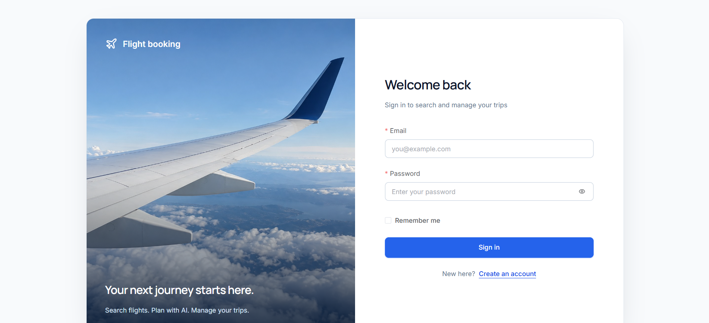
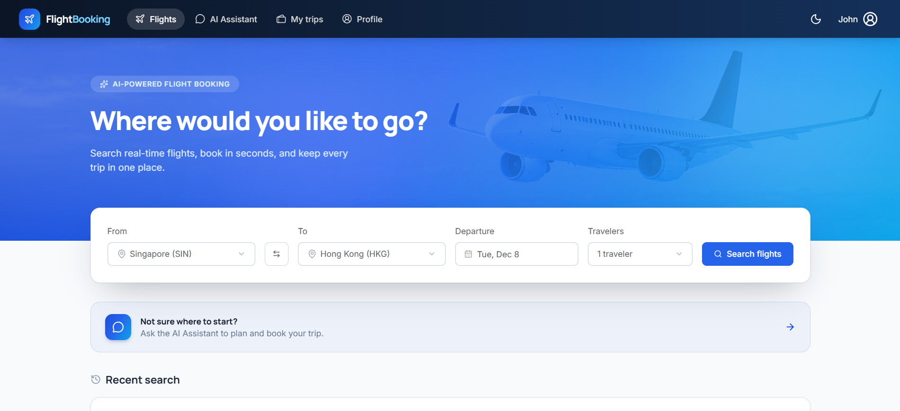
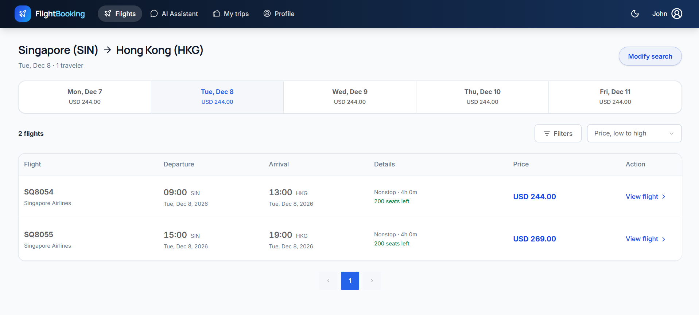
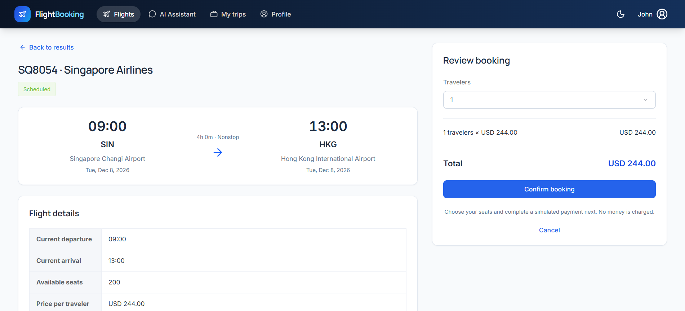
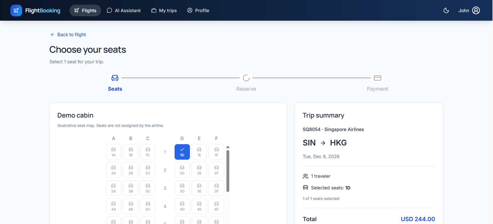
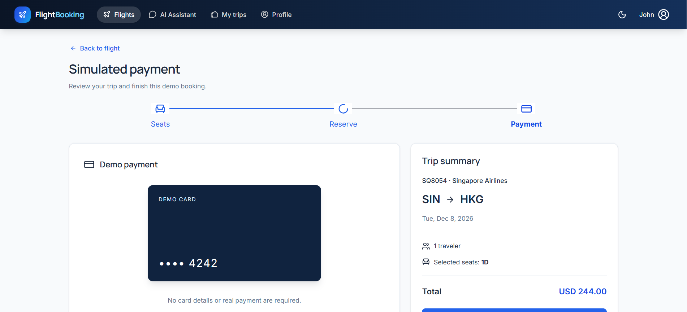
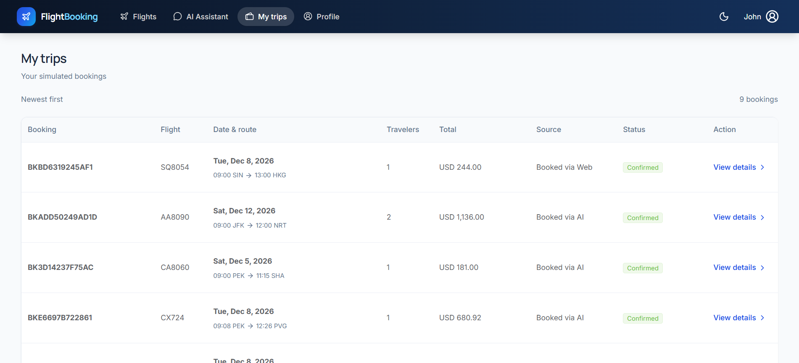
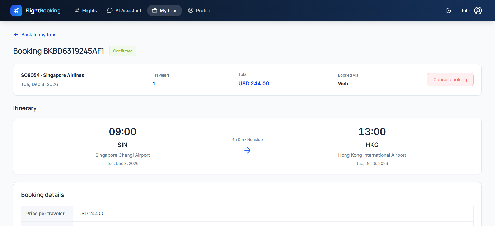
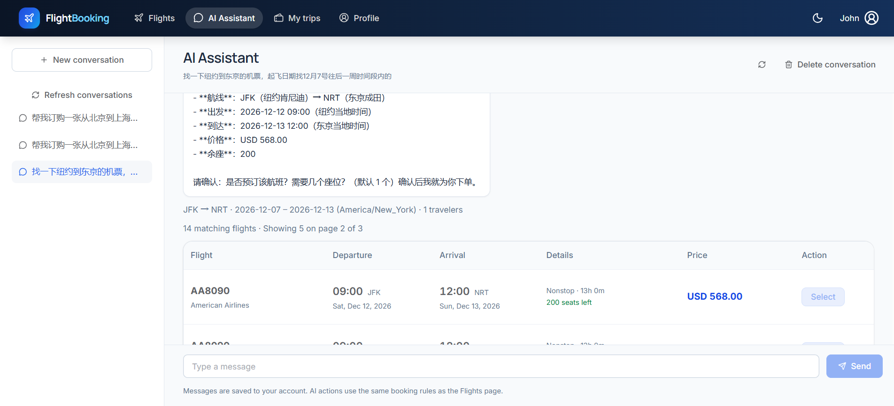
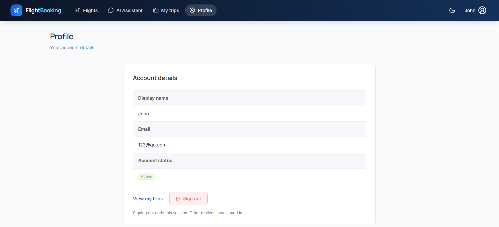

# Flight Booking

A simulated flight-booking application with flight search, reservation management, and an AI assistant. The project has three layers: a Vue frontend, a FastAPI chat service, and a Node.js REST backend backed by MongoDB Atlas.

## Backend — `backend/`

Built with **Node.js, Express, Mongoose, and MongoDB Atlas**. The backend owns database access, authentication, seat availability, and booking rules for both the standard UI and AI tools.

Booking creation and individual cancellation use **cross-collection transactions** to update bookings and seat inventory together. User-scoped UUID idempotency keys prevent duplicate bookings and repeated seat deductions when requests are retried. Bookings retain the price agreed at creation.

| API area | Responsibility |
| --- | --- |
| Authentication | Registration, login, current-user profiles, and logout with revocable 24-hour JWTs. |
| Airports and Airlines | Airport lookup and the active airline directory. |
| Flights | Flight details and searches by route, local departure date, passengers, and filters, with sorting and pagination. |
| Bookings | Create reservations, list and inspect the user's bookings, and cancel eligible bookings. |
| Sessions | Create, list, retrieve, and delete user-owned conversations. |
| Turns | Save each conversation round, its sequence, full message transcript, UI view, and pending/completed/failed status. |
| Administration | Manage user status, bookings, flight prices, schedules, and operational status. |
| Health | Report service and database connectivity. |

See the [backend API reference](docs/api-reference.md) for routes and data contracts.

## AI Middle Layer — `middle/`

Built with **Python and FastAPI**, connecting the chat interface to **DeepSeek's Chat Completions API**. The model requests tools for airport lookup, flight search, booking, and cancellation. The middle layer validates tool arguments, calls the Node.js APIs, and returns tool results to the model until it produces a final reply.

Conversations are persisted through the backend's **Sessions and Turns APIs**, without a separate Python database connection. User input is saved before execution; the full turn is saved on completion or a known failure. Saved conversations remain available across restarts until explicitly deleted.

Completed transcripts restore model context, while `Turn.view` supplies user/assistant text and event cards to the frontend. Repeated completed requests replay their saved results. Bearer tokens stay outside model messages. Run one worker and one service instance because conversation execution locks are process-local.

See the [middle-layer README](middle/README.md) for setup, restoration routes, and retry behavior.

## Frontend — `frontend/`

Built with **Vue 3, TypeScript, and Vite**, using **Pinia** for state management and **Vue Router** for navigation.

- **Tailwind CSS** handles layout, spacing, typography, and theming.
- **Element Plus** provides forms, inputs, tables, pagination, drawers, and dialogs.
- **lucide-vue-next** provides reusable icon components.

The interface supports registration/login, flight search and review, booking management, profiles, and AI chat. The chat sidebar loads the current user's sessions and restores ordered `Turn.view` messages and event cards from the middle layer instead of caching transcripts in browser storage.

Browser requests use `/api/*` for the Node.js backend and `/chat-api/*` for FastAPI. Both booking paths share the same backend validation and inventory rules.

See the [frontend README](frontend/README.md) for development commands and UI conventions.

### Screenshots

The following screenshots show the frontend's booking flow and AI assistant.

#### Sign in

#### Flight search

#### Search results

#### Flight details

#### Seat selection

#### Simulated payment

#### My trips

#### Booking details

#### AI assistant

#### Profile

